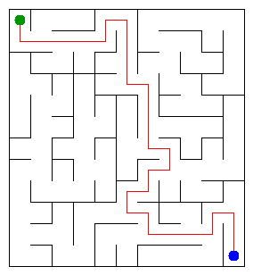

# Assignment 3. Maze Escape

Student ID: 253730  
Name: Kaiyrzhan Baktiyar
Group: SE-2519
Maze size: 12 x 11 (132 cells, 241 walls)

## Run

Java 17 or newer; no external dependencies. From this directory:

```sh
java tools/MakeVariant.java 253730 data
javac -d out src/*.java
java -cp out Main
java tools/Check.java
java -cp out Bench
```

Open `output/maze.html` to walk through the maze and inspect the path and zones.

## Program output

```text
Broken: 131
Kept: 110
Last broken wall: 182
MST cost: 38000
Heaviest broken wall: 708
Path length: 29
DFS visited: 72
Dead ends: 39
Zones: 10
Largest zone: 19
Is DAG: 0
Flow stages: 7
Fastest route cost: 13
```



## Questions

### Mission 0

`find` returns the representative of a cell's component; `union` joins two different components and reports whether a merge happened. The smaller tree is attached to the larger one, and iterative path compression makes every visited node point directly to the root. These operations take amortized O(alpha(n)) time.

### Mission 1

The rectangular grid is connected. Every successful union reduces the component count by one without creating a cycle, so reaching one component breaks exactly R*C-1 walls. There are R*(C-1)+C*(R-1) inner walls; subtracting the broken walls leaves (R-1)*(C-1).

### Mission 2

Kruskal and Prim both give 38000 on my data. Kruskal chooses the cheapest edge joining distinct components, while Prim chooses the cheapest edge leaving its growing tree; the cut property makes both choices safe. Since wall costs are distinct, the MST is unique.

### Mission 3

The broken-wall graph is connected and acyclic, so it is a tree. Two different simple paths between the same cells would create a cycle, hence the escape path is unique. DFS uses arrays as an explicit stack with a next-direction cursor, preserving up/right/down/left order without consuming the Java call stack.

### Mission 4

The first pass records finishing order in the original directed graph. Starting in decreasing finishing order on the reversed graph prevents a search from escaping into another unassigned component, so each second-pass search finds one complete SCC. With no self slides, a directed cycle exists exactly when some SCC has at least two vertices, so the graph is a DAG exactly when there are n zones.

### Mission 5

Kosaraju numbers source zones before their successors: every inter-zone slide goes from a smaller zone number to a larger one. Thus, when a zone is processed, all predecessor values are final; relaxing outgoing edges computes both the longest chain (initialized to one at every zone) and the shortest route (initialized only at the start zone). Building the condensed graph with minimum parallel costs takes expected O(n+m) time using hash maps, and the topological pass takes O(z+e), where z is the zone count and e the distinct inter-zone edge count.

## AI use

ChatGPT implemented the missing Java algorithms, added checks, ran the supplied checker and benchmarks, and drafted this README. The code and report are AI-assisted drafts; the student must review, adapt and understand every line before submission and defense. No external website or book code was used; the supplied starter utilities were retained. The local git commits were created during this assisted session, not as evidence of independent work over time.

## Timing (Mission 7)

OpenJDK 17.0.20, one container run of the supplied, unchanged Bench class; five runs per size, arithmetic means rounded by Bench, milliseconds. Raw values are in `output/benchmark.txt`.

| maze | Kruskal average (ms) | Prim average (ms) |
|---|---:|---:|
| 100 x 100 | 9 | 8 |
| 300 x 300 | 16 | 71 |
| 1000 x 1000 | 319 | 2068 |

Both times increase with the number of walls and cells; this grid has m=Theta(n). Kruskal sorts edges in O(m log m), while this lazy Prim implementation performs O(m) heap insertions/removals with O(log m) cost. These measurements include JVM warmup, garbage collection and container noise, so small-size ratios are not a precise scaling law.

## Complexity

n = cells, m = walls or slides. Auxiliary space includes graph structures constructed by the method, excluding the input itself. z = zones, e = distinct edges between zones.

| algorithm | time | space | assumptions |
|---|---|---|---|
| DSU initialization | O(n) | O(n) | Arrays for parent and size |
| DSU find / union | O(alpha(n)) amortized | O(1) per operation | O(n) shared DSU storage; compression and union by size |
| File-order maze | O(n + m alpha(n)) | O(n) | Connected rectangular grid |
| Kruskal | O(n + m log m + m alpha(n)) | O(n+m) | Primitive packed edge sorting |
| Prim | O(n + m log(m+1)) | O(n+m) | Connected grid; lazy priority queue |
| DFS escape | O(n+m) | O(n+m) | At most four neighbors per cell; explicit stack |
| Kosaraju | O(n+m) | O(n+m) | Two iterative DFS passes |
| Zone graph construction and route | Expected O(n+m); pass O(z+e) | O(z+e) | Hash-map min-edge deduplication; topological zone numbers |

## Validation

- Supplied `Check.java`: DSU checks and all 13 output values on tiny, small and dag pass.
- Added DSU checks: self union, repeated unions, component counts, empty DSU and 100000-cell chain.
- Additional stress check: iterative DFS, Kosaraju and DAG routes on a chain of 1000000 cells; single-cell maze checked.
- Kruskal and Prim agree on the personal variant (no Main warning).
- Personal data, PNG, HTML, results and benchmark results are included.

## Submission steps remaining

Fill in name and group. Review and adapt the AI-assisted work and explanations, then create a public GitHub repository and push the included `main` history. Submit that repository URL in Moodle before the deadline; this archive alone is not a Moodle submission.

```sh
git remote add origin https://github.com/YOUR_USERNAME/maze-escape.git
git push -u origin main
```

The git author `Assignment workspace <workspace@local>` identifies commits made in this environment; change it to your own identity for future commits if needed.
